<div align="center">



<p>
  <a href="https://www.linkedin.com/in/liam-swile-a4a951331"></a>
  <a href="mailto:dswile9@gmail.com"></a>
  <a href="https://github.com/ST10438679?tab=repositories"></a>
  
</p>

</div>

---

## 👋 About me

I'm a **Bachelor of Computer & Information Sciences** student at **IIE Varsity College** in Cape Town, and a **tutor** for fellow students. I like owning a feature from start to finish: modelling the data, building the API and the UI, writing the tests, then containerising and deploying it. My recent work spans three different .NET architectures: a **cloud-native Azure app**, a **secure role-based MVC system**, and a **containerised API + Blazor platform with CI**.

```yaml
focus:      backend & cloud development in .NET
currently:  Frontend Engineer & Integration Developer on my WIL team project · tutoring
backend:    ASP.NET Core Web API · MVC · EF Core · JWT auth · Swagger
frontend:   HTML5 · CSS3 · JavaScript (ES6+) · Blazor Server · Razor views · Bootstrap 5
cloud:      Azure App Service · Azure SQL · Functions · Table / Blob / Queue / File Share Storage
devops:     Docker Compose · GitHub Actions CI
testing:    xUnit · Moq · WebApplicationFactory integration tests
patterns:   Factory · Observer · Decorator · Repository
design:     UML · ERD · MS Project (WBS & scheduling)
languages:  English (fluent) · Afrikaans (basic)
looking:    junior / graduate .NET developer roles
```

<div align="center">
  
  
  
  
  
  <br />
  
  
  
  
  
  <br />
  
  
  
  
  
</div>

---

## 💼 Experience

**Tutor**, IIE Varsity College
<br /><sub>Supporting fellow students with programming and application development.</sub>

**Frontend Engineer & Integration Developer**, WIL team project (IIE Varsity College)
- Build responsive HTML / CSS / JavaScript screens from wireframes and storyboards, with client-side validation
- Connect the frontend to back-end APIs and database services, keeping data flowing securely between layers
- Test and debug integration points across modules, document the integration architecture and take part in code reviews

**General Assistant**, Almost Home Guesthouse · <sub>Jan 2018 – Jul 2019</sub>
<br /><sub>First point of contact for guests, bookings admin, and trusted with property access and guest safety on night shifts.</sub>

## 🎓 Education

**Bachelor of Computer & Information Sciences**, IIE Varsity College · <sub>in progress</sub>
<br />**National Senior Certificate** (Bachelor's admission), Bellville Hoër Tegniese Skool · <sub>2018</sub>

---

## 🚀 Featured projects

<table>
<tr>
<td width="50%" valign="top">

<a href="https://youtu.be/MJ8W7Ebr18c"></a>

### 🚚 [Logistics Management Platform](https://github.com/ST10438679/LMSA---Logistics-Management-System-Application)
Decoupled **ASP.NET Core Web API + Blazor Server** platform on **.NET 10** for logistics contracts and service requests, started with one `docker compose up`.

- JWT auth across every endpoint
- **Factory**, **Observer** and **Decorator** patterns, plus the Repository pattern
- Live USD → ZAR conversion and PDF contract uploads
- **18 integration tests** run by **GitHub Actions** on every push

`.NET 10` `Web API` `Blazor` `EF Core` `Docker` `GitHub Actions`

</td>
<td width="50%" valign="top">

<a href="https://youtu.be/wpI3cz68bWg"></a>

### ☁️ [Cloud Retail Application](https://github.com/ST10438679/CRA---Cloud-Retail-Application)
E-commerce style **ASP.NET Core MVC** app (customers, products, orders, cart, contracts) built on the **Azure** platform.

- All four **Azure Storage** services: Table, Blob, Queue and File Share
- **Azure Functions** (isolated worker) for uploads and queue messaging
- **Azure SQL** via EF Core, hosted on **Azure App Service**
- Admin and customer roles

`.NET 8` `Azure Functions` `Azure Storage` `Azure SQL`

</td>
</tr>
<tr>
<td width="50%" valign="top">

<a href="https://youtu.be/2eQNJYsmzCc"></a>

### 📑 [Contract Monthly Claim System](https://github.com/ST10438679/CMCS---Contract-Monthly-Claim-System)
Lecturers' claims move through a **two-stage approval** (Coordinator → Manager), with HR handling invoicing and reports.

- Four roles, each with its own controllers and views
- **Encrypted** supporting documents, stored outside the web root
- PDF invoices generated with **QuestPDF**
- Unit tests with **xUnit + Moq**

`.NET 8` `MVC` `EF Core` `SQL Server` `QuestPDF`

</td>
<td width="50%" valign="top">

### 🧠 What these projects show

| Skill | Where |
|---|---|
| REST APIs + JWT security | Logistics |
| Design patterns | Logistics |
| Cloud architecture | Cloud Retail |
| Automated tests + CI | Logistics, CMCS |
| Containers | Logistics |
| Encryption + role-based access | CMCS, Logistics |
| Iterating on feedback | CMCS |

<sub>▶ Click any thumbnail to watch the demo video.</sub>

</td>
</tr>
</table>

---

## 📊 GitHub activity

<div align="center">


<picture>
  <source media="(prefers-color-scheme: dark)" srcset="https://raw.githubusercontent.com/ST10438679/ST10438679/output/snake-dark.svg" />
  
</picture>

</div>

---

<div align="center">

<sub><i>Thanks for stopping by. If you're hiring for a junior .NET role, I'd love to chat.</i></sub>

<a href="mailto:dswile9@gmail.com"></a>

</div>
